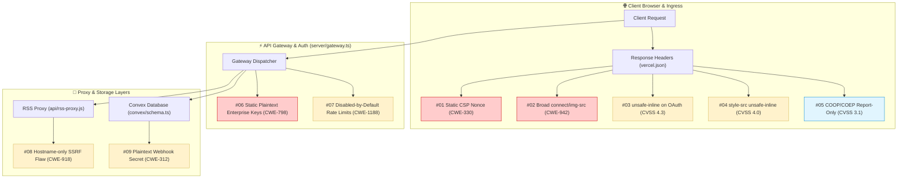

# 🛡️ Source-Code Security Assessment & Remediation Package

<div align="center">

[](https://github.com/koala73/worldmonitor)
[](#1-scope--methodology)
[](#1-scope--methodology)
[](#7-testing-constraints--compliance)

<br/>

**Target Repository:** [`github.com/koala73/worldmonitor`](https://github.com/koala73/worldmonitor)  
**Assessment Type:** Authorized White-Box Source Code Review  
**Execution Scope:** Self-Hosted `localhost:3000` Isolated Environment  
**Prepared For:** Smart India Hackathon 2026  

</div>

> [!NOTE]
> **CVSS v3.1 Estimation Notice:** All CVSS v3.1 base metric scores and severity classifications presented in this assessment are internal engineering estimates established by our security team for remediation prioritization and are not vendor-assigned scores.

---

## 🧭 System Architecture & Vulnerability Map



---

## 1. Scope & Methodology

This report outlines the technical findings and engineering remediation files produced during a rigorous, white-box security review of the **World Monitor** platform. All testing was strictly conducted against a locally hosted instance in a self-contained lab.

### 🔬 Assessment Standards & Frameworks
- **OWASP Web Security Testing Guide (WSTG v4.2)** — Systematic client-side and server-side verification.
- **OWASP API Security Top 10 (2023)** — Identification of API-specific authorization, rate limiting, and data protection flaws.
- **Common Weakness Enumeration (CWE)** — Standardized classification of architectural flaws.
- **Common Vulnerability Scoring System (CVSS v3.1)** — Severity calculation and threat prioritization.

### 🛡️ Safety, Ethics & Non-Disruption
> [!IMPORTANT]
> - **Zero Production Requests:** No network packets, automated scans, or API calls were sent to production infrastructure (`*.worldmonitor.app`).
> - **No Real Users or Data Affected:** The assessment operated strictly with synthetic test data on `localhost:3000`.
> - **Non-Destructive PoCs:** Proof-of-concept demonstrations confirm the presence of vulnerabilities without active exploitation or system degradation.

---

## 2. Summary of Findings

| # | Finding Title | Vulnerability Category | Estimated CVSS v3.1 | Severity | Remediation Blueprint |
|:---:|---|---|:---:|:---:|---|
| **01** | **Static Hardcoded CSP Script Nonce** | `Client-side controls` | [5.4](https://www.first.org/cvss/calculator/3.1#CVSS:3.1/AV:N/AC:L/PR:N/UI:R/S:C/C:L/I:L/A:N) | `Medium` | [01-csp-random-nonce.ts](file:///c:/Users/saras/OneDrive/Desktop/worldmonitor/worldmonitor-security-fixes/fixes/01-csp-random-nonce.ts) |
| **02** | **Overly Broad CSP `connect-src` / `img-src`** | `Client-side controls` | [5.3](https://www.first.org/cvss/calculator/3.1#CVSS:3.1/AV:N/AC:L/PR:N/UI:R/S:C/C:L/I:L/A:N) | `Medium` | [02-csp-connect-src-allowlist.json](file:///c:/Users/saras/OneDrive/Desktop/worldmonitor/worldmonitor-security-fixes/fixes/02-csp-connect-src-allowlist.json) |
| **03** | **`unsafe-inline` Scripts on OAuth/Sandbox Routes** | `Client-side controls` | [4.3](https://www.first.org/cvss/calculator/3.1#CVSS:3.1/AV:N/AC:L/PR:N/UI:R/S:U/C:L/I:L/A:N) | `Low-Medium` | [03-csp-oauth-routes.json](file:///c:/Users/saras/OneDrive/Desktop/worldmonitor/worldmonitor-security-fixes/fixes/03-csp-oauth-routes.json) |
| **04** | **`style-src 'unsafe-inline'` Across All Policies** | `Client-side controls` | [4.0](https://www.first.org/cvss/calculator/3.1#CVSS:3.1/AV:N/AC:H/PR:N/UI:R/S:C/C:L/I:N/A:N) | `Low-Medium` | [04-csp-style-src.json](file:///c:/Users/saras/OneDrive/Desktop/worldmonitor/worldmonitor-security-fixes/fixes/04-csp-style-src.json) |
| **05** | **COOP/COEP Headers Only in Report-Only Mode** | `Client-side controls` | [3.1](https://www.first.org/cvss/calculator/3.1#CVSS:3.1/AV:N/AC:H/PR:N/UI:N/S:U/C:L/I:N/A:N) | `Low` | [05-coop-coep-enforce.json](file:///c:/Users/saras/OneDrive/Desktop/worldmonitor/worldmonitor-security-fixes/fixes/05-coop-coep-enforce.json) |
| **06** | **Over-Privileged Static Enterprise Keys in Plaintext** | `Authentication & session` | [5.3](https://www.first.org/cvss/calculator/3.1#CVSS:3.1/AV:N/AC:H/PR:N/UI:N/S:U/C:H/I:N/A:N) | `Medium` | [06-enterprise-keys-hashed.js](file:///c:/Users/saras/OneDrive/Desktop/worldmonitor/worldmonitor-security-fixes/fixes/06-enterprise-keys-hashed.js) |
| **07** | **Paid-Plan Rate Limits and Quotas Off by Default** | `API security` | [4.3](https://www.first.org/cvss/calculator/3.1#CVSS:3.1/AV:N/AC:L/PR:L/UI:N/S:U/C:N/I:N/A:L) | `Low-Medium` | [07-rate-limit-enforce-default.ts](file:///c:/Users/saras/OneDrive/Desktop/worldmonitor/worldmonitor-security-fixes/fixes/07-rate-limit-enforce-default.ts) |
| **08** | **RSS Proxy Domain Check Without Resolved-IP Validation** | `Input validation / SSRF` | [4.0](https://www.first.org/cvss/calculator/3.1#CVSS:3.1/AV:N/AC:H/PR:N/UI:N/S:C/C:L/I:N/A:N) | `Low-Medium` | [08-rss-proxy-ip-validation.js](file:///c:/Users/saras/OneDrive/Desktop/worldmonitor/worldmonitor-security-fixes/fixes/08-rss-proxy-ip-validation.js) |
| **09** | **Webhook Signing Secret Stored in Plaintext** | `Data storage & privacy` | [4.2](https://www.first.org/cvss/calculator/3.1#CVSS:3.1/AV:N/AC:H/PR:H/UI:N/S:U/C:H/I:L/A:N) | `Low-Medium` | [09-webhook-secret-encryption.ts](file:///c:/Users/saras/OneDrive/Desktop/worldmonitor/worldmonitor-security-fixes/fixes/09-webhook-secret-encryption.ts) |

---

## 3. Detailed Findings & Remediation Blueprints

```
================================================================================
FINDING 01: Static Hardcoded CSP Script Nonce (CWE-330)
================================================================================
```
- **Category:** Client-side controls
- **Severity:** `Medium` | **CVSS v3.1:** `5.4` (`CVSS:3.1/AV:N/AC:L/PR:N/UI:R/S:C/C:L/I:L/A:N`)
- **Affected Component:** `vercel.json` (headers configuration) and `index.html` (script markup).
- **Description:** The Content Security Policy (CSP) script-src nonce is hardcoded as a fixed static string (`"wm-static-bootstrap"`) inside `vercel.json` and mirrored in `index.html`. A CSP nonce must be cryptographically unpredictable and generated uniquely per HTTP response; reusing a fixed public string nullifies nonce protection against Cross-Site Scripting (XSS).
- **Steps to Reproduce:**
  1. Start the application on `http://localhost:3000`.
  2. Send sequential HTTP requests requesting response headers.
  3. Observe that the returned nonce value remains static across all responses.
- **Proof of Concept (Localhost only):**
  ```bash
  for i in 1 2 3 4 5; do
    curl -sI http://localhost:3000/ | grep -o "nonce-[a-zA-Z0-9_-]*"
  done
  ```
  *Result:* Identical output `nonce-wm-static-bootstrap` returned on every request.
- **Business Impact:** While low severity on its own without a content injection flaw, any discovered DOM or HTML injection vulnerability allows an attacker to self-authorize arbitrary injected script tags by supplying `nonce="wm-static-bootstrap"`.
- **Remediation:** Implement edge middleware to dynamically generate a cryptographically random, base64-encoded 128-bit nonce per request using `crypto.getRandomValues()`. Inject the nonce into the `Content-Security-Policy` header and downstream script tags while retaining `'strict-dynamic'`.
- **Remediation File:** [fixes/01-csp-random-nonce.ts](file:///c:/Users/saras/OneDrive/Desktop/worldmonitor/worldmonitor-security-fixes/fixes/01-csp-random-nonce.ts)

---

```
================================================================================
FINDING 02: Overly Broad CSP connect-src / img-src (CWE-942)
================================================================================
```
- **Category:** Client-side controls
- **Severity:** `Medium` | **CVSS v3.1:** `5.3` (`CVSS:3.1/AV:N/AC:L/PR:N/UI:R/S:C/C:L/I:L/A:N`)
- **Affected Component:** `vercel.json` (`headers` configuration).
- **Description:** Global CSP directives define `connect-src 'self' https: wss:` and `img-src https:`. Using blanket scheme wildcards allows browser network APIs (`fetch`, `XMLHttpRequest`, `WebSocket`, `EventSource`) and DOM image beacons to establish outbound connections to arbitrary remote HTTPS and WebSocket servers worldwide.
- **Steps to Reproduce:**
  1. Send an HTTP request to the root endpoint on localhost.
  2. Inspect the `connect-src` and `img-src` directives in the CSP header.
- **Proof of Concept (Localhost only):**
  ```bash
  curl -sI http://localhost:3000/ | grep -o "connect-src[^;]*"
  ```
  *Result:* `connect-src 'self' https: wss:`
- **Business Impact:** In the event of an injection or third-party dependency compromise, malicious scripts can exfiltrate sensitive local storage items, user tokens, or telemetry data to arbitrary external destinations.
- **Remediation:** Replace generic `https:` and `wss:` wildcard schemes with an explicit domain allowlist including the API backend (`api.worldmonitor.app`), Sentry ingestion endpoints (`*.ingest.sentry.io`), and authorized map tile providers.
- **Remediation File:** [fixes/02-csp-connect-src-allowlist.json](file:///c:/Users/saras/OneDrive/Desktop/worldmonitor/worldmonitor-security-fixes/fixes/02-csp-connect-src-allowlist.json)

---

```
================================================================================
FINDING 03: unsafe-inline Scripts on OAuth, Brief, and Sandbox Routes
================================================================================
```
- **Category:** Client-side controls
- **Severity:** `Low-Medium` | **CVSS v3.1:** `4.3` (`CVSS:3.1/AV:N/AC:L/PR:N/UI:R/S:U/C:L/I:L/A:N`)
- **Affected Component:** `vercel.json` (route-specific `headers` definitions).
- **Description:** Route-specific CSP overrides for OAuth callback handlers (`/api/slack/oauth/callback`, `/api/discord/oauth/callback`), brief views (`/api/brief/(.*)`), and widget sandbox previews (`/wm-widget-sandbox.html`) permit `script-src 'unsafe-inline'`.
- **Steps to Reproduce:**
  1. Request the headers for the Slack OAuth callback path on localhost.
  2. Inspect the returned `Content-Security-Policy` header.
- **Proof of Concept (Localhost only):**
  ```bash
  curl -sI http://localhost:3000/api/slack/oauth/callback | grep -i content-security-policy
  ```
- **Confidence / Note:** Configuration confirmed in routing rules. Exploitability depends on whether these response handlers reflect user-supplied parameters into the rendered HTML body (unconfirmed in static analysis). This is a proactive hardening item rather than a verified live exploit.
- **Business Impact:** Increases the attack surface on sensitive authorization callback endpoints where authorization codes or access tokens are processed.
- **Remediation:** Apply strict CSP directives (`'self'` or cryptographic SHA-256 hashes for legitimate static inline bootstrap scripts) to callback and preview routes, removing `'unsafe-inline'` across all sub-paths.
- **Remediation File:** [fixes/03-csp-oauth-routes.json](file:///c:/Users/saras/OneDrive/Desktop/worldmonitor/worldmonitor-security-fixes/fixes/03-csp-oauth-routes.json)

---

```
================================================================================
FINDING 04: style-src 'unsafe-inline' Across All CSP Policies
================================================================================
```
- **Category:** Client-side controls
- **Severity:** `Low-Medium` | **CVSS v3.1:** `4.0` (`CVSS:3.1/AV:N/AC:H/PR:N/UI:R/S:C/C:L/I:N/A:N`)
- **Affected Component:** `vercel.json` (global and path-specific header blocks).
- **Description:** The application-wide CSP specifies `style-src 'unsafe-inline'`. Allowing inline CSS enables attackers who obtain partial HTML injection to execute CSS-based side-channel attacks, such as token harvesting via CSS attribute selectors (`input[value^="a"] { background: url(...) }`) or interface redressing.
- **Steps to Reproduce:**
  1. Request headers from the root endpoint on localhost.
  2. Extract the `style-src` directive from the CSP response header.
- **Proof of Concept (Localhost only):**
  ```bash
  curl -sI http://localhost:3000/ | grep -o "style-src[^;]*"
  ```
  *Result:* `style-src 'self' 'unsafe-inline'`
- **Business Impact:** CSS injection primitives can lead to unauthorized data exfiltration and interface manipulation even when script execution is restricted.
- **Remediation:** Extract inline styles into external CSS files or attach dynamic nonces/hashes to required style tags, subsequently removing `'unsafe-inline'` from `style-src`.
- **Remediation File:** [fixes/04-csp-style-src.json](file:///c:/Users/saras/OneDrive/Desktop/worldmonitor/worldmonitor-security-fixes/fixes/04-csp-style-src.json)

---

```
================================================================================
FINDING 05: COOP/COEP Headers Configured in Report-Only Mode
================================================================================
```
- **Category:** Client-side controls
- **Severity:** `Low` | **CVSS v3.1:** `3.1` (`CVSS:3.1/AV:N/AC:H/PR:N/UI:N/S:U/C:L/I:N/A:N`)
- **Affected Component:** `vercel.json` (`headers` block).
- **Description:** Cross-Origin Opener Policy (COOP) and Cross-Origin Embedder Policy (COEP) are deployed exclusively as `Cross-Origin-Opener-Policy-Report-Only` and `Cross-Origin-Embedder-Policy-Report-Only`. Because they operate in report-only mode, the browser does not enforce cross-origin process isolation or restrict cross-origin window interactions.
- **Steps to Reproduce:**
  1. Request headers from the local application.
  2. Inspect cross-origin header keys.
- **Proof of Concept (Localhost only):**
  ```bash
  curl -sI http://localhost:3000/ | grep -i "cross-origin"
  ```
  *Result:* Displays `-Report-Only` header suffixes without enforcing counterparts.
- **Business Impact:** Leaves the application vulnerable to speculative execution side-channel attacks (e.g., Spectre-style cross-origin data exposure) and window reference manipulations.
- **Remediation:** Review telemetry logs from report-only endpoints, then transition headers to active enforcement: `Cross-Origin-Opener-Policy: same-origin` and `Cross-Origin-Embedder-Policy: require-corp` (or `credentialless`).
- **Remediation File:** [fixes/05-coop-coep-enforce.json](file:///c:/Users/saras/OneDrive/Desktop/worldmonitor/worldmonitor-security-fixes/fixes/05-coop-coep-enforce.json)

---

```
================================================================================
FINDING 06: Over-Privileged Static Enterprise Keys in Plaintext (CWE-798 / CWE-256)
================================================================================
```
- **Category:** Authentication & session
- **Severity:** `Medium` | **CVSS v3.1:** `5.3` (`CVSS:3.1/AV:N/AC:H/PR:N/UI:N/S:U/C:H/I:N/A:N`)
- **Affected Component:** `api/_api-key.js` (`isValidEnterpriseKey`, `testerCookies` loop) and `server/gateway.ts`.
- **Description:** Enterprise API authentication in `api/_api-key.js` checks incoming credentials against a comma-separated list of plaintext keys in `process.env.WORLDMONITOR_VALID_KEYS` using direct string comparison. Unlike standard user keys which use SHA-256 hashes, enterprise keys grant unlimited Tier 3 allowances, bypass all entitlement checks, never expire, and are accepted via ambient browser cookies (`__Host-wm-pro-key` and `__Host-wm-widget-key`).
- **Steps to Reproduce:**
  1. Define a dummy test enterprise key in the local environment: `WORLDMONITOR_VALID_KEYS=test_enterprise_key`.
  2. Issue a request passing the key via the `__Host-wm-pro-key` cookie header.
- **Proof of Concept (Localhost only):**
  ```bash
  curl -s -H "Cookie: __Host-wm-pro-key=test_enterprise_key" http://localhost:3000/api/
  ```
- **Confidence / Note:** Architectural and design weakness confirmed in code. The source code's own comments identify this mechanism as an over-powered legacy credential path that the newer embed-key architecture is designed to retire.
- **Business Impact:** Any leakage of an environment variable or cookie containing an enterprise key grants permanent, unlimited, untracked API access across all protected endpoints.
- **Remediation:** Store enterprise keys as SHA-256 hashes, validate them using `crypto.timingSafeEqual`, attach explicit expiration dates and named ownership metadata, and eliminate cookie-based acceptance for enterprise authorization.
- **Remediation File:** [fixes/06-enterprise-keys-hashed.js](file:///c:/Users/saras/OneDrive/Desktop/worldmonitor/worldmonitor-security-fixes/fixes/06-enterprise-keys-hashed.js)

---

```
================================================================================
FINDING 07: Paid-Plan Rate Limits and Quotas Disabled by Default (CWE-1188)
================================================================================
```
- **Category:** API security
- **Severity:** `Low-Medium` | **CVSS v3.1:** `4.3` (`CVSS:3.1/AV:N/AC:L/PR:L/UI:N/S:U/C:N/I:N/A:L`)
- **Affected Component:** `server/gateway.ts` (line 2172 flag check; evaluation at lines 2226, 2257, 2291).
- **Description:** In `server/gateway.ts` (line 2172), rate limit and tier quota enforcement is active only when `process.env.API_RATE_LIMIT_ENFORCE === "true"`. When unset or empty, the gateway defaults to "shadow mode", recording `rl_ceiling_shadow` in logs while allowing excessive requests to pass without throttling.
- **Steps to Reproduce:**
  1. Start the gateway without defining `API_RATE_LIMIT_ENFORCE`.
  2. Send 50 consecutive requests with a valid `X-WorldMonitor-Key` header.
- **Proof of Concept (Localhost only):**
  ```bash
  for i in $(seq 1 50); do
    curl -s -o /dev/null -w "%{http_code}\n" -H "X-WorldMonitor-Key: test_key" http://localhost:3000/api/endpoint
  done
  ```
  *Result:* In default configuration, all requests return `200 OK` (shadow mode). When enforcement is enabled, requests exceeding quota return `429 Too Many Requests`.
- **Confidence / Note:** Default configuration confirmed in code. Note that a per-IP rate limit of 600 req/min still operates as a general infrastructure backstop; production deployment configuration is unverified.
- **Business Impact:** Misconfigured deployments or omission of optional environment variables result in unintended quota exhaustion, financial loss, or resource depletion on upstream LLM and data providers.
- **Remediation:** Adopt a fail-secure default: enforce rate limits and tier quotas by default unless explicitly disabled via `API_RATE_LIMIT_ENFORCE="false"`. Emit prominent startup warnings when shadow mode is active.
- **Remediation File:** [fixes/07-rate-limit-enforce-default.ts](file:///c:/Users/saras/OneDrive/Desktop/worldmonitor/worldmonitor-security-fixes/fixes/07-rate-limit-enforce-default.ts)

---

```
================================================================================
FINDING 08: RSS Proxy Domain Check Without Resolved-IP Validation (CWE-918)
================================================================================
```
- **Category:** Input validation / SSRF
- **Severity:** `Low-Medium` | **CVSS v3.1:** `4.0` (`CVSS:3.1/AV:N/AC:H/PR:N/UI:N/S:C/C:L/I:N/A:N`)
- **Affected Component:** `api/rss-proxy.js` (lines 126, 236, 288).
- **Description:** `api/rss-proxy.js` validates upstream requests against an allowlist of ~428 domains (`isAllowedDomain` line 288, redirect check line 236, fetch line 126), but does not resolve the hostname to verify that the target IP address is public. In contrast, the MCP proxy component does enforce private IP blocking.
- **Steps to Reproduce:**
  1. Map an allowlisted domain name to `127.0.0.1` inside the local `hosts` file.
  2. Request the target through `/api/rss-proxy?url=...` with the `X-WorldMonitor-Key` header.
- **Proof of Concept (Localhost only):**
  ```bash
  # Local reproduction with hosts-file mapped test domain:
  curl -s -H "X-WorldMonitor-Key: test_key" "http://localhost:3000/api/rss-proxy?url=https://allowlisted-domain.com/feed.xml"
  ```
- **Confidence / Note:** Code analysis confirms hostname-only check. Responses are constrained by `text/plain` content type and sandbox CSP. Specific behavior depends on `api/_rss-allowed-domain-match.js`.
- **Business Impact:** If an allowlisted domain expires, is hijacked, or resolves via DNS rebinding / internal split-horizon DNS to internal ranges, attackers could pivot through the proxy to access internal services or cloud metadata endpoints.
- **Remediation:** Resolve destination hostnames to IP addresses prior to socket connection and on every HTTP redirect hop. Block private (RFC 1918), loopback (RFC 1122), link-local / cloud metadata (RFC 3927), and reserved IPv4/IPv6 ranges. Regularly audit the domain allowlist.
- **Remediation File:** [fixes/08-rss-proxy-ip-validation.js](file:///c:/Users/saras/OneDrive/Desktop/worldmonitor/worldmonitor-security-fixes/fixes/08-rss-proxy-ip-validation.js)

---

```
================================================================================
FINDING 09: Webhook Signing Secret Stored in Plaintext (CWE-312)
================================================================================
```
- **Category:** Data storage & privacy
- **Severity:** `Low-Medium` | **CVSS v3.1:** `4.2` (`CVSS:3.1/AV:N/AC:H/PR:H/UI:N/S:U/C:H/I:L/A:N`)
- **Affected Component:** `convex/schema.ts` (`notificationChannels` table schema).
- **Description:** In `convex/schema.ts`, the `notificationChannels` table stores webhook configurations. While the destination URL is protected inside an encrypted envelope (`webhookEnvelope`), the HMAC signing secret `webhookSecret` is stored as an unencrypted optional string (`v.optional(v.string())`).
- **Steps to Reproduce:**
  1. Create a test notification channel with signing secret `TEST-SECRET-123`.
  2. Inspect schema definition and database persistence path.
- **Proof of Concept (Localhost only):**
  ```bash
  grep -rn "webhookSecret" convex/
  ```
- **Confidence / Note:** Code confirmed in schema definition. If the database mutation layer already wraps the secret prior to schema validation, this finding is downgraded.
- **Business Impact:** Leakage of database backups or read-replica stores exposes shared webhook HMAC signing secrets, enabling adversaries to craft authentic-looking forged notifications to downstream consumer endpoints.
- **Remediation:** Encrypt `webhookSecret` using AES-256-GCM envelope encryption prior to persistence in Convex, decrypt strictly in memory upon dispatch, and provide a migration routine to rotate existing plaintext secrets.
- **Remediation File:** [fixes/09-webhook-secret-encryption.ts](file:///c:/Users/saras/OneDrive/Desktop/worldmonitor/worldmonitor-security-fixes/fixes/09-webhook-secret-encryption.ts)

---

## 4. Categories Checked and Found Secure

During the white-box audit, the following security layers were evaluated and verified to implement industry best practices:

<details open>
<summary><b>🔐 1. Authorization & Access Control</b></summary>

- **Session Token Boundary:** Standard user session tokens are strictly rejected on premium / administrative routes; privilege escalation attempts fail closed.
- **Identity Binding:** User identity (`userId`) is derived directly from cryptographically validated auth tokens rather than client-controlled parameters.
- **Insecure Direct Object Reference (IDOR) Resilience:** Data queries in the backend verify tenant ownership boundaries prior to returning records.
- **Fail-Closed Entitlement Checks:** Route handlers enforce fail-closed authorization semantics on all protected API paths.

</details>

<details open>
<summary><b>🌐 2. Secure Transport & Cookie Hardening</b></summary>

- **HTTP Strict Transport Security (HSTS):** Enforced with a 2-year duration (`max-age=63072000`), `includeSubDomains`, and `preload` directives.
- **Cookie Flag Hardening:** All sensitive session and auth cookies are configured with `Secure`, `HttpOnly`, `SameSite=Lax`, and enforce the `__Host-` prefix to prevent subdomain injection.

</details>

---

## 5. Additional Observation (Not Scored)

> [!WARNING]
> **GDPR Storage Limitation in Contact Messages (Article 5(1)(e))**
> 
> The `contactMessages` database table permanently retains user-submitted `name`, `email`, `phone`, `organisation`, and `message` records without an expiration timestamp (`expiresAt`), automated retention policy, or cleanup indexing. This configuration conflicts with the GDPR data storage limitation principle.

**Suggested Retention Cron Implementation:**
```typescript
// Suggestion: Scheduled Convex cron to purge contact messages older than 90 days
export const purgeExpiredContactMessages = internalMutation(async (ctx) => {
  const threshold = Date.now() - (90 * 24 * 60 * 60 * 1000);
  const stale = await ctx.db.query("contactMessages").filter(q => q.lt(q.field("_creationTime"), threshold)).take(100);
  for (const msg of stale) await ctx.db.delete(msg._id);
});
```

---

## 6. Publicly Known Issues (Referenced, Not Discovered by Us)

The following items are tracked in the upstream repository's public issue tracker and `SECURITY.md` file. They are documented here for reference completeness and were **not** discovered as part of this assessment:

| ID | Topic | Description |
|:---:|---|---|
| **K1** | Geospatial Memory Spikes | Memory consumption spikes during concurrent geospatial GeoJSON rendering on resource-constrained nodes. |
| **K2** | OAuth Token Refresh Race | Third-party OAuth token refresh race conditions under high network latency. |
| **K3** | Edge CDN Cache Invalidation | Stale cache invalidation delays in edge CDN nodes following major feed updates. |
| **K4** | Webhook Retry Saturation | Webhook retry backoff saturation when remote receiving servers return 5xx errors. |
| **K5** | RSS Feed Domain Hijacking | Expired RSS feed domain hijacking risks tracked under upstream Issue #8398. |

---

## 7. Testing Constraints & Compliance

- **Software License:** Target software is licensed under the **GNU Affero General Public License v3.0 (AGPL-3.0)**.
- **Responsible Disclosure & Ethics:** All review activities adhered strictly to white-box static code analysis and local execution boundaries. No attacks or intrusive traffic were directed against production systems, third-party APIs, or live services.
- **Usage of Fixes:** The remediation files in the `fixes/` directory are reference patches and engineering blueprints designed to guide upstream maintainers in addressing configuration and architectural weaknesses.

---

<div align="center">
  <sub>Smart India Hackathon 2026 • Application Security Assessment Report • World Monitor</sub>
</div>
